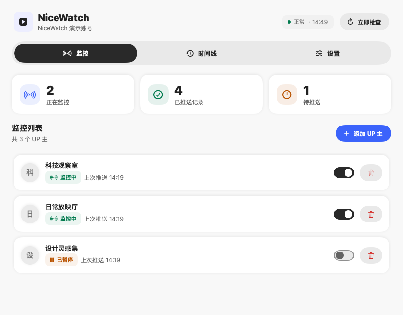
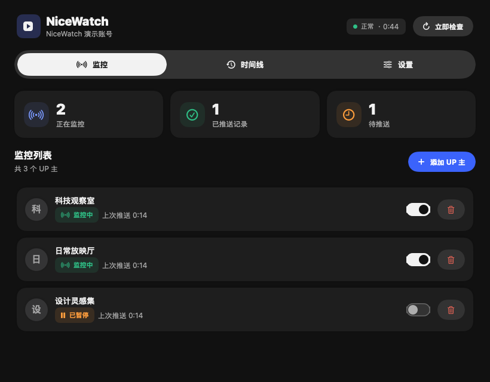
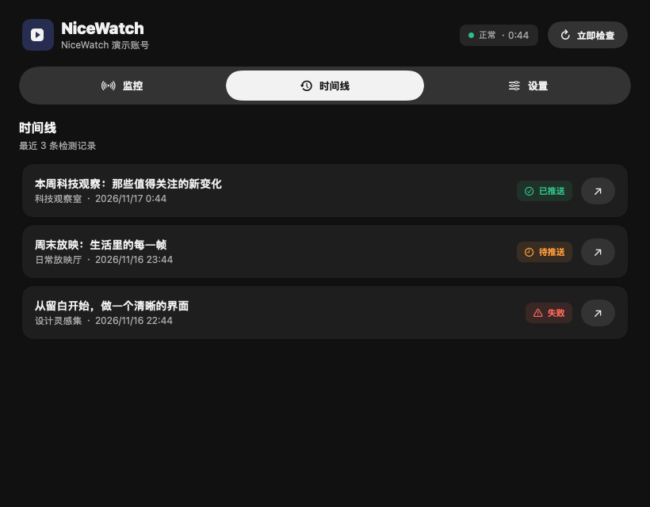
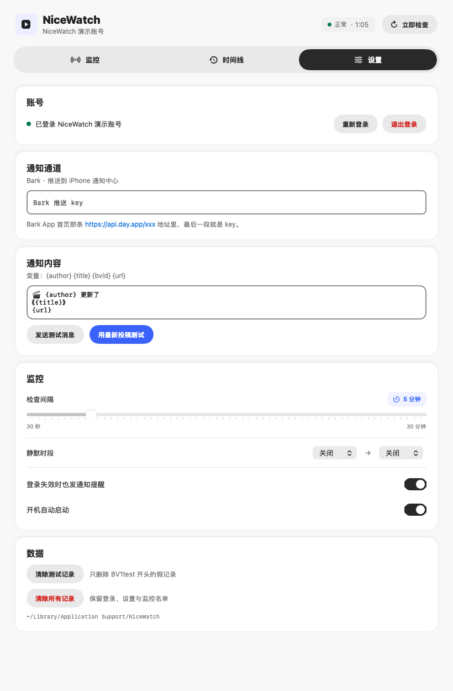
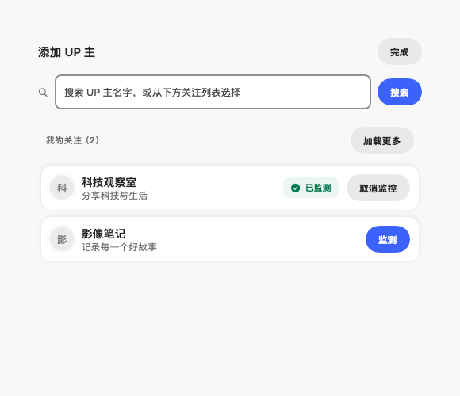
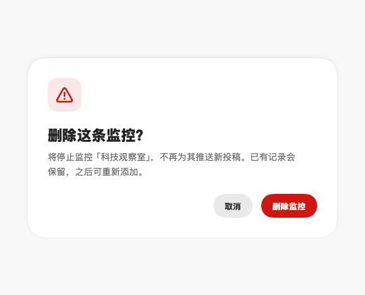
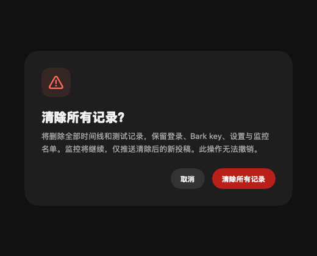
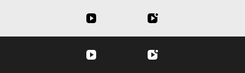

# NiceWatch


> 一个 macOS 菜单栏小工具：盯着你选的 B站 UP 主，一更新就推到你 iPhone 通知中心。

「喜欢的 UP 主更新了，但 B站 App 的通知总是不来」——这个小工具就是为这件事写的。
它常驻菜单栏，按你设定的间隔轮询投稿列表，发现新视频立刻通过 [Bark](https://github.com/Finb/Bark)
推送到手机，比 App 自带推送更及时、更可控。

界面采用参考 [Spectrum 2](https://uilingo.dev/styles/spectrum-2/) 的高对比度设计：浅灰画布、独立卡片、蓝色主操作与深色选中态，支持深浅色模式。

[](LICENSE)


---

## 特性

- **菜单栏常驻** — 无 Dock 图标，关窗口不退出，不占地方
- **扫码登录** — 用手机 B站 App 扫一下就行，不需要账号密码
- **两种添加方式** — 从「我的关注」列表一键监测，或直接搜索 UP 主名字
- **真实更新才推** — 添加时自动建立基线，不会把历史视频一股脑推给你
- **推送测试** — 一键用「监控中 UP 的最新真实投稿」走完整推送链路，验证手机能不能收到
- **静默时段** — 夜里不想被吵就设个时间段，期间只记录不推送
- **风控友好** — 逐 UP 串行请求 + 指数退避，撞到风控自动降速，不会越撞越死
- **登录态加密落盘** — AES-GCM 加密，密钥绑定本机硬件，不用系统钥匙串
- **开机自启** — 可选，通过 LaunchAgent 实现

## 系统要求

- macOS 13 Ventura 或更高
- 从源码构建需要 Xcode 或 Command Line Tools（提供 Swift 5.9+ 工具链）
- iPhone 上安装 [Bark](https://apps.apple.com/app/bark-customed-notifications/id1403753865)（免费）

## 安装

前往 [Releases](https://github.com/EmoXW/NiceWatch/releases/latest) 下载 `NiceWatch-版本号-universal.dmg`，打开后将 `NiceWatch.app` 拖入 `Applications` 文件夹。

安装包同时支持 Apple Silicon 与 Intel，要求 macOS 13 或更高。当前使用 ad-hoc 签名，尚未经过 Apple 公证，首次启动时 macOS 可能提示无法验证开发者，请确认下载来源。

## 从源码构建

```bash
git clone https://github.com/EmoXW/NiceWatch.git
cd NiceWatch

# 构建（产物为当前目录下的 NiceWatch.app）
./build.sh

# 启动
open NiceWatch.app

# 可选：构建通用版 DMG（输出到 dist/）
./tools/package_dmg.sh
```

首次启动会弹出主窗口并显示登录二维码，用**手机 B站 App 扫码**，并在手机上点「确认登录」。

### 1. 配置推送

打开 **Bark App → 首页**，会看到一条形如 `https://api.day.app/xxxxxxxx` 的地址，
把最后那段 `xxxxxxxx` 复制出来，填进 NiceWatch 的「设置 → 通知通道 → 推送 key」。

填好后点「发送测试消息」，手机上应该立刻收到一条通知。

### 2. 添加要监控的 UP 主

点「添加 UP 主」：

- **我的关注** — 自动拉取你的关注列表，找到目标后点右侧「监测」
- **搜索** — 顶部输入框可以直接搜任意 UP 主

添加时会记录该 UP 主当前的投稿作为**基线**，之后只有比基线更新的视频才会推送。

### 3. 调整检查间隔

「设置 → 监控 → 检查间隔」滑块，**步进 30 秒**，范围 **30 秒 ~ 30 分钟**。
标签规则：60 的整数倍显示「N 分钟」，其余显示「N 秒」（如 90 秒显示「90 秒」）。

> 间隔越短越及时，但请求也越频繁。日常用 1~5 分钟比较平衡；不建议长期低于 30 秒
> ——那基本等于持续压测 B站接口，容易招来风控。

## 界面

以下为真实 SwiftUI 界面使用离线演示数据渲染的预览。
### 监控 · 浅色



### 监控 · 深色



<details>
<summary>查看时间线、设置和添加 UP 主</summary>

#### 时间线



#### 设置



#### 添加 UP 主



#### 操作确认





</details>

### 菜单栏图标

左侧为普通状态，右侧为未读状态；分别展示浅色和深色背景。



界面分三个页签：

| 页签 | 作用 |
|---|---|
| **监控** | 已监控的 UP 主列表，可暂停/恢复、取消监测 |
| **时间线** | 检测到的视频记录及其推送状态（已推送 / 待推送 / 失败 / 静默） |
| **设置** | 账号、Bark key、通知模板、检查间隔、静默时段、开机自启、数据目录 |

菜单栏图标点开可以快速查看状态、立即检查或打开主窗口。

暂停和恢复立即更新监控状态；删除监控需要确认，已有记录会保留。设置的「数据」区可清除测试记录，或在二次确认后清除所有记录。清除所有记录保留登录、Bark key、其他设置和监控名单，并以清除时刻作为历史截止时间，避免旧投稿重复推送。已发出的通知无法撤回。

## 工作原理

### 为什么是「逐 UP 轮询」而不是关注动态

最初的实现用「关注动态 feed」（一次请求就能覆盖所有关注），实测发现一个问题：
该接口只返回**所有关注者混在一起的最近 20 条**，20 条在实测中只覆盖了 4.6 小时。

如果关注了几百个 UP 主，被你监控的那个很容易被别人的更新挤出这个窗口；
电脑睡眠几小时再唤醒，基本必然漏检。

所以主通道改为**逐个 UP 查 `space/wbi/arc/search`**——监控名单通常只有个位数，
成本完全可控，而且每个 UP 都能稳定拿到自己最近的 10 条投稿，不受其他人更新频率影响。
动态 feed 保留为**兜底**：只有当这一轮所有投稿列表请求都失败时才用它。

### 判定「新视频」

```
未见过该 bvid
  && 发布时间 > 该 UP 的基线时间
  && 不在静默时段
  → 推送
```

每条视频记录在 `seen` 表里走状态机：

```
baseline（历史，不推送） ──→ pending（待推送） ──→ notified（已推送）
                                              ↘ failed（共尝试 3 次仍失败）
```

**先落盘再发送**：保存失败时停止发送；每轮检查先恢复待推送记录，即使视频已不在接口返回列表中也能重试。最多尝试 3 次，成功后不再发送；静默期间暂停重试，暂停或移除的 UP 不重试。

Bark 请求和本地保存不是原子事务：服务端已接收、但客户端超时或保存成功状态前崩溃时，重试仍可能重复通知。

最多保留最近 800 条终态记录（含基线、已推送、失败和静默），待推送记录不裁剪。清理时会推进对应 UP 的历史截止时间，截止时间及以前的投稿不再作为新视频推送。

### 请求策略与风控退避

- 每个 UP 之间间隔 700ms 串行请求，单轮上限 20 个 UP，按名单轮换，超过 20 个时分多轮覆盖
- 命中 `-101`（账号未登录）→ 视为登录失效，暂停监控并提醒重新登录（每天最多一次）
- 命中 `-352` / `-412` / `-799`（风控）→ 对该 UP 做指数退避：

```
第 1 次失败 → 10 分钟
第 2 次失败 → 30 分钟
第 3 次失败 → 2 小时
第 4 次及以后 → 6 小时（封顶）
```

退避期内直接跳过该 UP（不浪费请求），一旦成功立刻清零。局部风控不会拖垮整个监控。

### 登录态怎么存

放在应用自己的数据目录

```
~/Library/Application Support/NiceWatch/session.bin   (权限 0600)
```

内容用 **AES-GCM** 加密，密钥由「本机硬件 UUID + 应用固定盐」经 HKDF-SHA256 派生。

- **能防住**：别人翻看数据目录时看不到明文 cookie；文件被拷到另一台机器上解不开（密钥随机器变化）
- **不能防住**：已经能在本机以你的身份执行任意代码的攻击者——他跑同样的派生流程也能解开

> 为什么不用钥匙串？这个应用是 ad-hoc 签名的，每次重新构建签名身份都会变，
> 而钥匙串 ACL 绑定旧身份，会导致启动时长时间卡在授权、重启后登录态丢失（实测卡过 29 秒）。
> 改用加密文件后这两个问题都消失，且重建多少次都不受影响。

### 关于 iMessage

早期版本用「发 iMessage 给自己」作为通知通道，已**整体移除**。

原因是实测走不通：发给自己的 iMessage 会同步到 Mac 上的「信息」，Mac 端把消息标记为已读后，
已读状态跨设备同步，iPhone 就不再弹通知了。即使做了「不激活启动 + 发完关窗 + 隐藏应用」
三重规避，Mac 端仍会标记已读。通知的意义被抵消，于是换成了 Bark。

## 命令行工具

不开界面的调试与自检入口：

```bash
swift test                          # 离线监控可靠性回归测试
swift run NiceWatch --selftest       # 7 项接口与配置自检
swift run NiceWatch --storetest      # 持久化往返回归测试
swift run NiceWatch --backofftest    # 风控退避曲线测试
swift run NiceWatch --simulate       # 走一遍完整推送链路（等同设置页的测试按钮）
```

开发辅助工具：

- `tools/bili_probe.py` — B站接口可行性诊断，需要本地登录态 `tools/.bili_session.json`（含真实 cookie，已被忽略，请勿提交）
- `tools/make_qr.js` — 用 JXA + CoreImage 把文本生成二维码 PNG
- `tools/package_dmg.sh` — 构建通用版 DMG，并生成 SHA-256 校验文件
- `tools/build_icons.py` — 从图标母版生成多尺寸图标与 ICNS：`python3 tools/build_icons.py`
- `tools/render_ui_preview.swift` — 使用临时数据离线渲染深浅色界面，不读取真实账号，不发送推送

在 macOS 上更新预览图：

```bash
swiftc -parse-as-library $(find Sources/NiceWatch -name '*.swift' ! -name main.swift) \
  tools/render_ui_preview.swift -o /tmp/nicewatch-preview
/tmp/nicewatch-preview .shots/spectrum-2
```

检查生成结果后，将需要展示的图片复制到 `docs/images/`。设置页同时输出普通窗口和长页版本。

## 目录结构

```
Sources/NiceWatch/
├── main.swift           入口（--selftest / --storetest / --backofftest / --simulate / GUI）
├── App.swift            MenuBarExtra + AppKit 主窗口 + 单实例保护
├── IconArtwork.swift    菜单栏模板图标（普通 / 未读）
├── AppModel.swift       核心状态机：登录、监控循环、去重、推送、退避
├── BiliAPI.swift        B站接口封装 + WBI 签名
├── Models.swift         数据模型与设置项
├── Store.swift          本地 JSON 持久化
├── SessionStore.swift   登录态持久化（加密文件）
├── SessionCrypto.swift  AES-GCM 加解密 + 机器绑定密钥派生
├── Notifier.swift       Bark 推送通道
├── LaunchAtLogin.swift  开机自启（LaunchAgent）
├── Theme.swift          Spectrum 2 设计系统（配色、卡片、胶囊按钮、开关与原生滑块）
├── Views.swift          SwiftUI 界面
├── SelfTest.swift       无界面自检与回归测试
└── Log.swift            日志（stderr + 文件）

tools/
├── bili_probe.py        接口可行性诊断脚本
├── make_qr.js           JXA 二维码生成
├── build_icons.py       应用图标导出
├── package_dmg.sh       通用版 DMG 打包
└── render_ui_preview.swift  离线界面预览

Assets/                 图标母版、ICNS 与设计说明
docs/images/            README 使用的界面预览
Tests/NiceWatchTests/    离线可靠性回归测试
```

数据目录：`~/Library/Application Support/NiceWatch/`

| 文件 | 内容 |
|---|---|
| `data.json` | 监控名单、设置、视频记录 |
| `session.bin` | 登录 cookie（AES-GCM 加密，权限 0600） |
| `app.log` | 运行日志 |

## 常见问题

**二维码不显示 / 一直转圈**
看 `~/Library/Application Support/NiceWatch/app.log`，通常是网络问题或接口返回异常。

**手机收不到通知**

1. 在设置里点「发送测试消息」，它会直接回显错误原因
2. 确认 Bark App 已允许通知；`level=timeSensitive` 需要开启「时效性通知」权限
3. 服务端返回成功但仍没收到 → 检查 Bark App 内是否有该消息、是否被专注模式拦截

**监控没反应**
看 `app.log` 里的「检查完成」行，会打印这一轮监控了几个 UP、拉到几条、命中几条。

**登录失效了**
菜单栏图标或设置页会提示，点「重新登录」重新扫码即可。

**想让它开机自己跑**
设置里打开「开机自动启动」。注意：它会写入 `~/Library/LaunchAgents/com.wyh.nicewatch.plist`，
里面记录的是**当前 `.app` 的绝对路径**。如果你之后移动了应用位置，需要关掉再打开一次这个开关。

## 已知限制

- **Mac 必须开机联网**。睡眠期间不监控；唤醒后会立即补检一次，但补不回实时性。
- **B站接口非官方**，随时可能变更或加强风控。签名与端点集中在 `BiliAPI.swift`，方便快速跟进。
- **ad-hoc 签名且未公证**，安装时可能出现开发者验证提示；当前 Release 不具备 Developer ID 签名与 Apple 公证。
- 只在 macOS 13+ 上验证过；更早版本未测试。

## 贡献

欢迎提 Issue 和 PR。改动接口相关代码前，建议先跑 `--selftest` 确认基线可用。

## 许可证

[MIT](LICENSE)

## 免责声明

本项目仅供个人学习与自用，与哔哩哔哩（bilibili）官方无任何关联。
它通过非公开接口读取你自己的账号数据，请自行评估使用风险；
请合理设置轮询间隔，不要用于高频抓取或任何商业用途。
因使用本工具导致的账号异常、数据丢失等问题，作者不承担责任。
